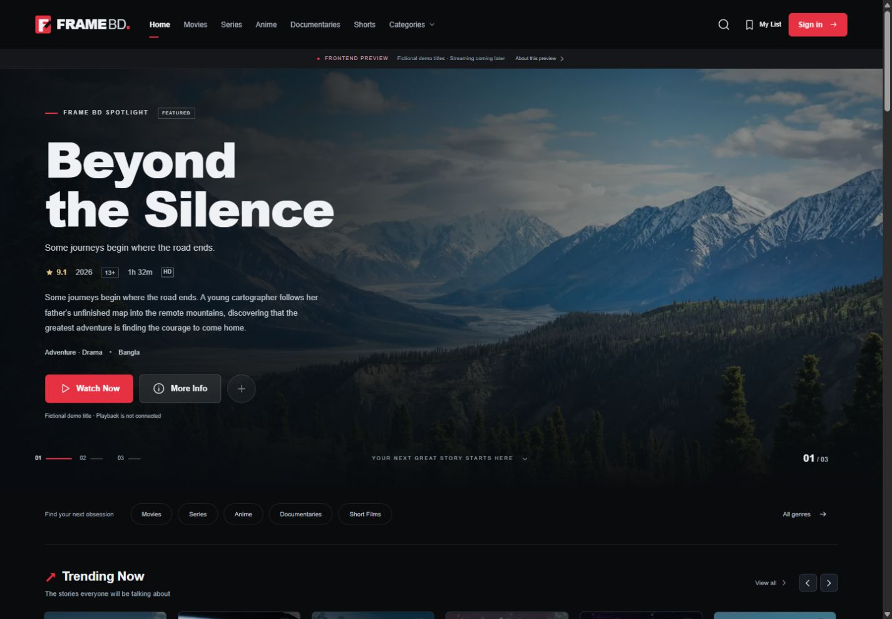

# Frame BD

**Frame BD is a streaming platform for movies, series, anime, documentaries and short films.** Viewers can discover titles, keep a watchlist and pick up where they left off. A protected admin dashboard lets operators publish content, manage media and configure the platform.



## Project overview

| Area | What you can do |
| --- | --- |
| **Discover** | Browse by genre, search the catalog and explore title details, seasons and episodes on desktop or mobile. |
| **Watch** | Play authorized media with adaptive HLS, quality and speed controls, alternate audio and subtitles. |
| **Your library** | Save titles in a browser watchlist as a guest, or sign in to keep your watchlist, history and viewing progress with your account. |
| **Admin workspace** | Manage titles, episodes, artwork, subtitles and video processing. Configure bank, bKash and Nagad receiving details as a Super Admin. |
| **Access** | Browse public content as a guest. The server checks account and subscription status before granting access to premium playback. |

The application uses **Next.js App Router**, **TypeScript** and **Tailwind CSS** for the web experience, **PostgreSQL** and **Prisma** for data, and **Better Auth** with SMTP for account verification. A separate **FFmpeg** worker converts authorized uploads to HLS. **HLS.js** handles adaptive playback in supported browsers, and private **R2 or S3** storage holds deployed media.

## Windows setup

Requirements: Node.js 24 LTS, npm and PostgreSQL 17 binaries. This machine has PostgreSQL at `C:\Program Files\PostgreSQL\17\bin`. Set `$env:POSTGRES_BIN` if yours differs. The local helper creates only a project-owned cluster under `.local/postgres`, listening on `127.0.0.1:55432`; it does not alter the system PostgreSQL service. It generates private credentials in `.env` and retains existing configuration.

PowerShell, first terminal:

```powershell
# Run from the cloned Frame BD repository.
npm.cmd ci
npm.cmd run db:start
npm.cmd run db:generate
npm.cmd run db:migrate
npm.cmd run db:restrict
npm.cmd run db:seed
# Optional, local development only: 30 fictional titles; no accounts or payments.
npm.cmd run db:seed:demo
npm.cmd run mail:dev
```

Keep that terminal running for the local SMTP receiver. In a second terminal:

```powershell
# Run from the cloned Frame BD repository.
npm.cmd run dev
```

Open [Frame BD](http://localhost:3000). Use **localhost**, matching `BETTER_AUTH_URL`, rather than a LAN IP or another origin. Do not run two Next servers on port 3000.

For this existing configured workspace, dependencies, migrations, runtime-role restriction and seeds are already installed. On later starts, run only `db:start`, `mail:dev` and `dev` in the appropriate terminals. Never overwrite the generated `.env` with the empty example.

## Verification emails and accounts

Register from `/register`; email verification is required before login. Local mode receives real SMTP messages into `.local/mailbox/messages.jsonl` instead of sending to internet addresses. Open that private file in your editor and follow the verification link from your latest message. Messages include raw MIME; quoted-printable long lines may contain `=` line wraps, which must be removed when copying a URL. Verification/reset links are sensitive and expire; never publish the inbox or share them. For normal internet delivery, configure your SMTP provider, `EMAIL_DELIVERY_MODE=external`, TLS and your verified sending domain in `.env`, then restart Next.

No default account, admin password or premium entitlement exists. See the report for the explicit verified-account admin promotion command. Guest watchlists stay in the browser; signed-in watchlists persist separately in PostgreSQL.

## Production mode on this machine

Keep PostgreSQL and SMTP running, stop the dev server, then:

```powershell
npm.cmd run build
npm.cmd run start
```

For deployment, configure a hosted PostgreSQL database, separate runtime/migration users, canonical HTTPS origin, secure random auth secret, external SMTP and backups. Run `db:migrate`, `db:generate`, `db:seed` (not demo), then build/start. The loopback database/restrict helpers are for this local cluster only. Configure `.env.example` values in server-side environment settings; no credentials belong in client code.

## Checks

With the local application, database and SMTP receiver running:

```powershell
npm.cmd run lint
npm.cmd run typecheck
npm.cmd test
npm.cmd run db:validate
npm.cmd run db:status
npm.cmd run db:check
npm.cmd run test:backend
npm.cmd run test:admin
npm.cmd run test:streaming
npm.cmd run test:routes
```

`db:check` creates and removes a uniquely named disposable database using local migration credentials; it never resets the application database. Backend tests use only loopback PostgreSQL/SMTP, disposable `example.test` accounts and signed provider fixtures, then remove their own records. They honor auth retry limits, so take approximately 30 seconds. Keep them off shared/production databases. Route smoke expects the optional fictional catalog.

`npm.cmd run db:maintenance` removes expired sessions/tokens/rate windows; schedule it appropriately in deployment. Stop Next/SMTP with Ctrl+C, then `npm.cmd run db:stop` when finished. Database and private inbox files persist across restarts.

## Integration boundaries

Checkout is disabled. Stripe webhook verification is implemented, and bank, bKash and Nagad receiving details are administrative settings. Payment verification and premium activation require a verified provider event. For deployed video processing, configure a private R2/S3 bucket with CORS and run `npm run worker:stream` on a separate host with FFmpeg and FFprobe. The local demo catalog contains fictional titles, and the streaming sample uses an original generated clip.

Open `/admin` with an existing verified Admin/Super Admin account. For first owner setup, use the explicit `admin:grant` command in the Step 4 report. Test accounts are removed; no default admin password exists. Admin writes are audited; payments and subscriptions cannot be manually marked successful. Run backend and admin integration suites sequentially because they temporarily modify scoped fixtures and platform settings in this isolated local environment.

See [development progress](DEVELOPMENT_PROGRESS.md), [backend and authentication](STEP3_REPORT.md), [admin dashboard](STEP4_REPORT.md) and [streaming setup](STEP5_REPORT.md).
